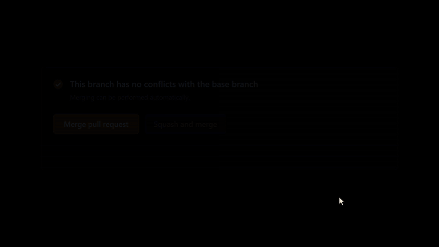
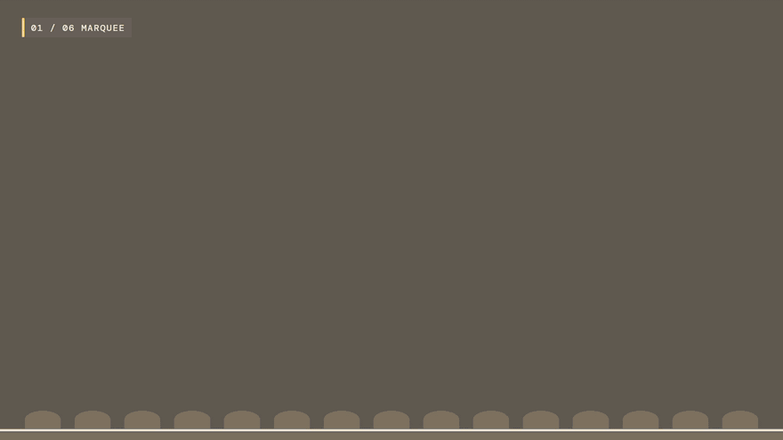
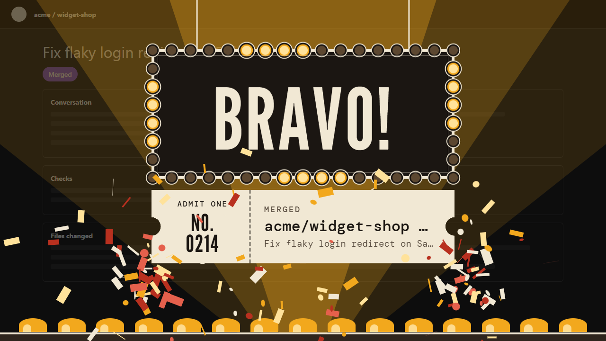
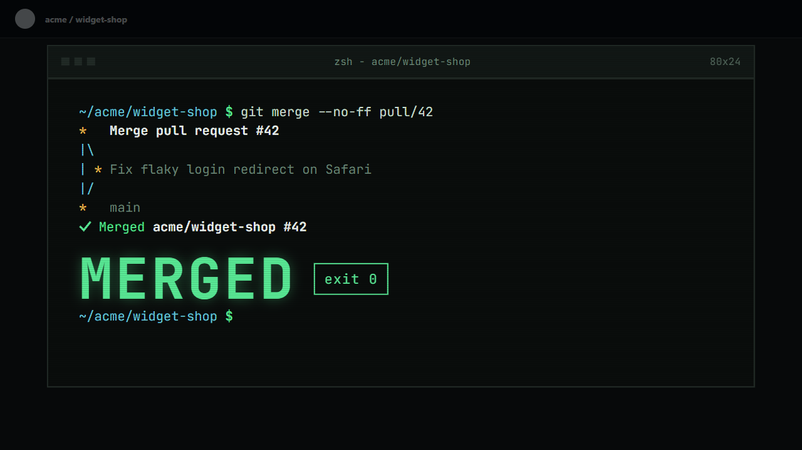
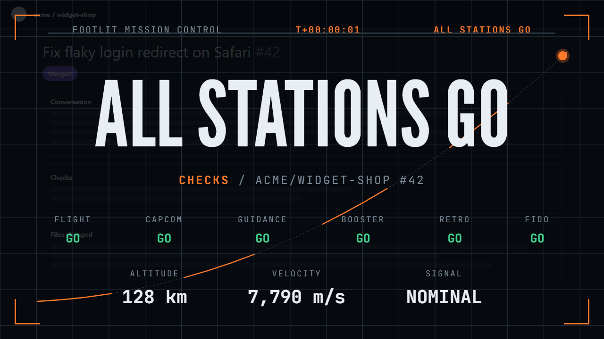
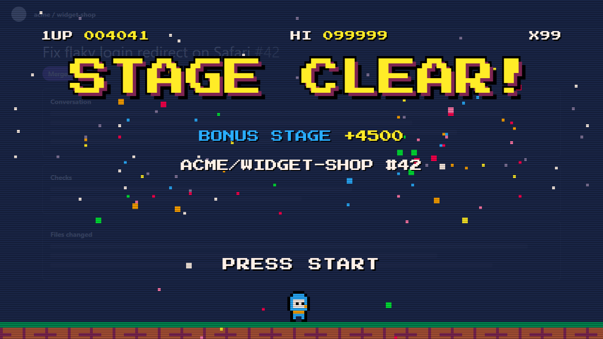
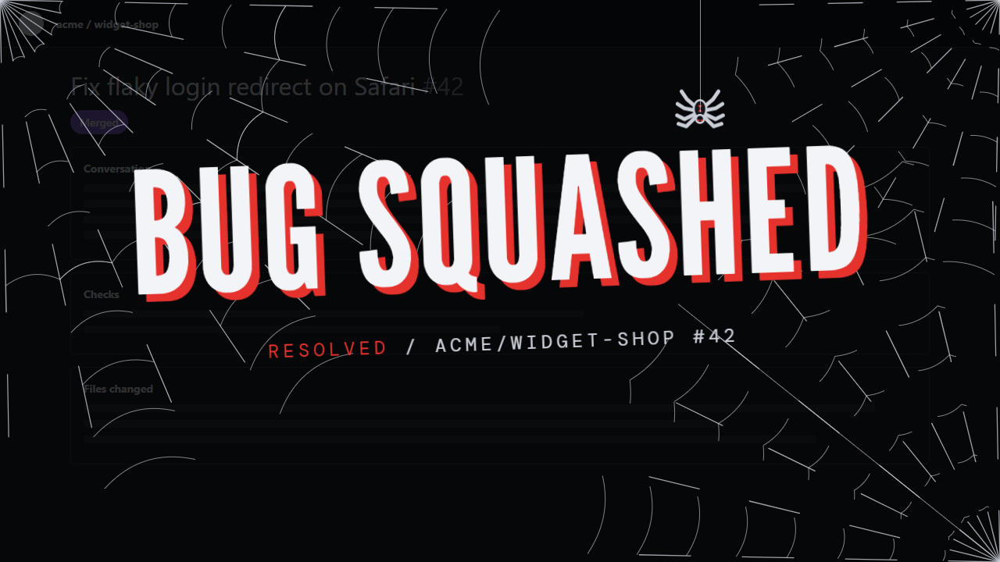
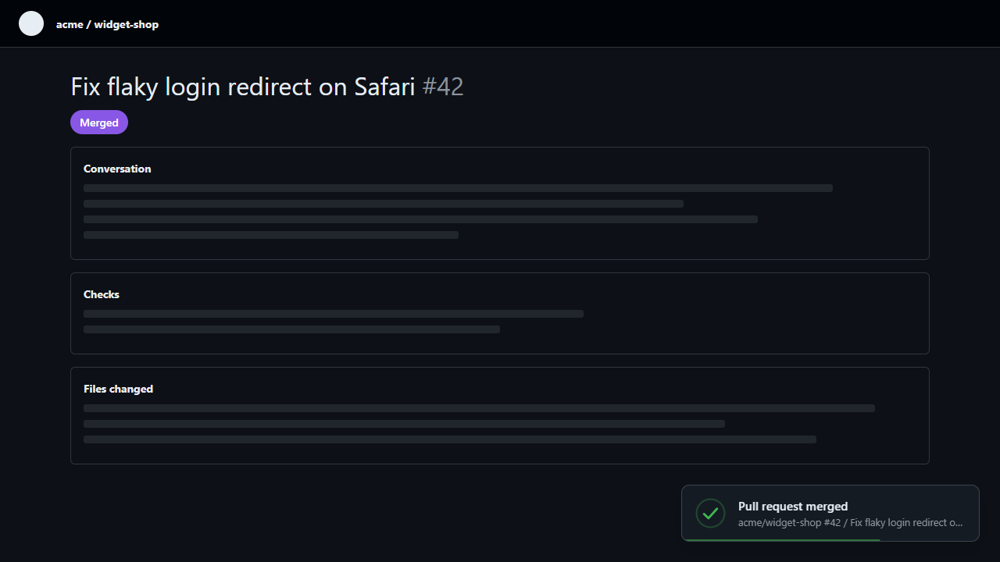

<h1 align="center">Footlit</h1>

<p align="center"><b>GitHub, with stage lighting.</b><br>
A free browser extension that plays a themed full-screen animation when you merge a pull request, pass checks or publish a release.</p>

<p align="center">
  <a href="https://chromewebstore.google.com/detail/fkjnlcolffmaaneilmchdejmlkgnimlf"><b>Add to Chrome</b></a> &nbsp;·&nbsp;
  <a href="https://addons.mozilla.org/en-US/firefox/addon/footlit/"><b>Add to Firefox</b></a> &nbsp;·&nbsp;
  <a href="https://footlit-app.vercel.app"><b>Try it in your browser</b></a>
</p>

<p align="center">
  <a href="https://github.com/ahmedammad1709/footlit/stargazers"></a>
  <a href="LICENSE"></a>
  
  
</p>

<p align="center"></p>

Footlit gives GitHub moments a proper entrance: merge a pull request, watch checks go green, publish a release, put a site live, and the page answers with a full-screen animation in the theme you chose. Free, no account, nothing leaves your machine.

If you like it, a star on this repo helps other developers find it.

Works in Chrome and other Chromium browsers (111+) and in Firefox (140+).

## What it reacts to

| Group | Events |
|---|---|
| Repositories | created, deleted, forked |
| Pull requests | opened, merged, closed |
| Checks and deploys | checks passed, checks failed, site or deploy live |
| Releases and issues | release published, issue closed |

Footlit only reacts to things it sees happen in a tab you are looking at. Opening a pull request that is already merged, or checks that are already green, never plays anything.

## Themes

<p align="center"></p>

<table>
  <tr>
    <td width="33%"><br><b>Marquee</b>: theatre lights and confetti</td>
    <td width="33%"><br><b>Terminal</b>: a shell and a merge graph</td>
    <td width="33%"><br><b>Mission Control</b>: countdown and GO/NO-GO</td>
  </tr>
  <tr>
    <td><br><b>Pixel Arcade</b>: stage clear, game over</td>
    <td><br><b>Web Crawler</b>: webs, spiders, tears when the build breaks</td>
    <td><br><b>Quiet</b>: one small toast, for the office</td>
  </tr>
</table>

Every theme has an applause, a farewell and an alarm version, honours reduced motion, and any event can use its own theme. Press Esc to dismiss a show, or switch on quiet mode.

## Install (development)

```
npm install
npm run build
```

Open `chrome://extensions`, turn on **Developer mode**, choose **Load unpacked** and select the **`dist`** folder. Reload any open GitHub tabs once.

## Commands

| Command | What it does |
|---|---|
| `npm run build` | Chrome build into `dist/` (with source maps) |
| `npm run build:firefox` | Firefox build into `dist-firefox/` |
| `npm test` | Detector tests plus the theme matrix, in headless Chrome |
| `npm run test:detectors` / `npm run test:themes` | Either half on its own |
| `npm run package` | Minified store zips in `release/` (Chrome and Firefox) |
| `npm run store-assets` | Store screenshots and promo tiles into `store/` (run `build` first) |
| `npm run icons` | Re-render the toolbar icons from `src/assets/logo*.svg` |
| `npm run typecheck` | TypeScript, no emit |

## How it is put together

```
src/
  content/      runs on github.com: navigation watcher + one detector per event
    detectors/  repoCreated, prMerged (opened/merged/closed), ci, deployLive, issueClosed, releaseForked
  engine/       overlay stage (Shadow DOM), timing, particles, show orchestration
  themes/       one file + stylesheet per theme; each exports play(ctx)
  popup/        toolbar popup: theme tiles, eleven events with Rehearse and an on/off switch, quiet mode
  options/      settings page with a sticky live-preview dock
  shared/       events, settings, messages, fonts, design tokens
  background/   service worker (hands fonts to the page; GitHub's CSP blocks extension fonts)
scripts/        build, packaging, store assets, and the test rigs
docs/           privacy policy, store listing text
```

See `PROJECT.md` for the roadmap and decisions, and `DESIGN.md` for the design system.

## Adding a theme

Create `src/themes/<name>.ts` (and `.css`), export a `Theme` with `play(ctx)`, add it to `src/themes/index.ts`, and run `npm run test:themes`. A theme draws into `ctx.box`, sizes itself from its container (`cqw`/`cqh` units), checks `ctx.reduced`, and must resolve when `ctx.signal` aborts.

## Firefox

`npm run build:firefox` rewrites the manifest (background scripts, `options_ui`, gecko id) and uses the same code. It needs Firefox 140 or later and passes `web-ext lint` with no warnings. `npm run test:firefox` loads it into a real Firefox and checks detection, fonts under GitHub-style CSP, and playback. For manual testing use `about:debugging` -> This Firefox -> Load Temporary Add-on. `npm run package:source` builds the source zip that addons.mozilla.org may request.

## Privacy

Footlit reads github.com pages in your browser to notice events and plays an animation. Settings and the activity log stay in your browser. Nothing is sent anywhere. See `docs/PRIVACY.md`.

## Known limits

- Detectors rely on GitHub's page markup, which changes. Each has tests against fixtures, and the activity log plus `localStorage.setItem('footlit:debug','1')` show what was noticed.
- No sound (by design, for now), no mobile support, no GitHub Enterprise Server (github.com only).
- Starring a repository and terminal pushes are not detected.

## Website

The marketing site lives in `site/` (Next.js, static export) and reuses the extension's engine and themes for its live demos. See `site/README.md`. Related commands: `npm run site-assets` (renders the mockup images) and, inside `site/`, `npm run prep`, `npm run dev`, `npm run build`.

## License

[MIT](LICENSE) © Ammad Ahmed, [Codeveil Studio](https://codeveilstudio.tech).

## Contributing

Bug reports, new theme ideas and detector fixes are welcome: open an issue or a pull request. A new theme is a single file, see "Adding a theme" above.
